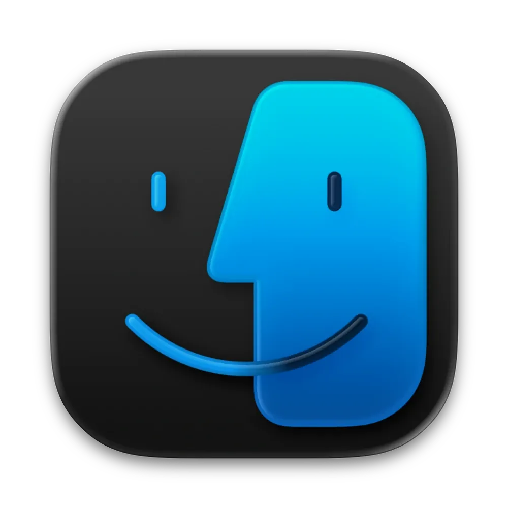

<p align="center">
  
</p>

<h1 align="center">tranandroi</h1>

<p align="center">
  <strong>Native macOS Finder-Style File Manager for Android (MTP)</strong><br/>
  แอปจัดการและถ่ายโอนไฟล์ระหว่าง Mac และมือถือ Android (เช่น Samsung Galaxy S25 Ultra) ด้วยดีไซน์แบบ macOS Finder แท้ๆ
</p>

<p align="center">
  <a href="https://github.com/blurskyday/tran-droid-mac/releases/download/v1.0.0/tranandroi.dmg"><strong>⬇ ดาวน์โหลดตัวติดตั้ง tranandroi.dmg (v1.0.0)</strong></a>
  &nbsp;•&nbsp;
  <a href="https://github.com/blurskyday/tran-droid-mac/releases/download/v1.0.0/tranandroi-macOS.zip"><strong>⬇ ดาวน์โหลดไฟล์ซิป tranandroi-macOS.zip (v1.0.0)</strong></a>
</p>

---

## ภาพรวม (Overview)

บนระบบปฏิบัติการ macOS ตัว **Finder** จะไม่รองรับการเปิดดูไฟล์จากมือถือ Android ผ่านสาย USB (โปรโตคอล MTP) โดยตรง **`tranandroi`** จึงถูกพัฒนาขึ้นด้วย **Swift + SwiftUI + AppKit** เชื่อมต่อกับไลบรารี **`libmtp`** ในระดับ Native เพื่อให้ผู้ใช้ Mac สามารถเปิดดูพรีวิวและโอนย้ายไฟล์กับมือถือ Android ได้ลื่นไหลด้วยหน้าตาและประสบการณ์ใช้งานที่เหมือนกับ **macOS Finder** มากที่สุด

---

## ฟีเจอร์หลัก (Key Features)

### 1. มุมมองไฟล์ครบทั้ง 4 รูปแบบตามมาตรฐาน macOS Finder
* **Icons View (`⌘1`)** — แสดงไอคอนโฟลเดอร์สีฟ้าสไตล์ Finder พร้อมโหลด Thumbnail พรีวิวรูปภาพจากมือถือ Android โดยตรง และมีแถบเลื่อนปรับขนาดไอคอน (56px – 140px)
* **List View (`⌘2`)** — แสดงตารางรายการไฟล์ พร้อมคลิกหัวคอลัมน์เพื่อเรียงลำดับตาม `Name`, `Date Modified`, `Size`, `Kind`
* **Columns View (`⌘3`)** — มุมมอง **Miller Columns** เอกลักษณ์ของ Finder คลิกโฟลเดอร์เพื่อแตกคอลัมน์ถัดไปทางขวา และแสดงหน้าต่าง Preview/Inspector ในคอลัมน์ขวาสุดเมื่อเลือกไฟล์
* **Gallery View (`⌘4`)** — แสดงภาพพรีวิวขนาดใหญ่ด้านบน พร้อมแถบเลื่อน Filmstrip ด้านล่าง และแผงข้อมูลไฟล์ด้านขวา

### 2. การถ่ายโอนข้อมูลระหว่าง Mac ↔ Android ที่ครบครัน
* **Drag & Drop** — ลากไฟล์หรือโฟลเดอร์จาก macOS Finder มาวางในหน้าต่าง `tranandroi` เพื่ออัปโหลดเข้าโฟลเดอร์ปัจจุบันบน Android ได้ทันที
* **Dual-Pane Split Mode (`⌘⌥S`)** — โหมดแบ่งครึ่งหน้าต่าง **Android ↔ Mac** ในหน้าจอเดียว พร้อมปุ่มคัดลอกข้ามฝั่งในคลิกเดียว
* **Recursive Folder Transfer** — รองรับการคัดลอกทั้งไฟล์เดี่ยวและโฟลเดอร์ซ้อนโฟลเดอร์ พร้อมแถบแสดงความคืบหน้า (Progress Bar) แบบเรียลไทม์
* **จัดการไฟล์ครบวงจร** — สร้างโฟลเดอร์ใหม่ (`⌘⇧N`), เปลี่ยนชื่อไฟล์/โฟลเดอร์, ลบไฟล์, และดับเบิลคลิกเพื่อเปิดไฟล์จาก Android บน Mac ทันที

### 3. ระบบเชื่อมต่อ USB MTP แบบ Uncached & แก้ปัญหาพอร์ตชนอัตโนมัติ
* ใช้ `LIBMTP_Open_Raw_Device_Uncached` ทำให้เชื่อมต่อและอ่านรายชื่อไฟล์เฉพาะโฟลเดอร์ที่เปิดอยู่ได้ทันทีในระดับมิลลิวินาที แม้ในมือถือจะมีรูปภาพหลายหมื่นรูป
* **Auto USB Conflict Resolver** — จัดการหยุดโปรเซส `ptpcamerad` ของ macOS ที่ชอบแย่งพอร์ต USB อัตโนมัติ และตรวจจับหากมีแอปอื่น (เช่น `OpenMTP`, `Android File Transfer`) ล็อกพอร์ต USB อยู่ พร้อมปุ่มสลับการเชื่อมต่อในคลิกเดียว

---

## คีย์ลัด (Keyboard Shortcuts)

| คีย์ลัด | การทำงาน |
| :--- | :--- |
| `⌘1` | สลับเป็นมุมมอง **Icons** |
| `⌘2` | สลับเป็นมุมมอง **List** |
| `⌘3` | สลับเป็นมุมมอง **Columns (Miller Columns)** |
| `⌘4` | สลับเป็นมุมมอง **Gallery** |
| `⌘[` / `⌘]` | ย้อนกลับ (Back) / ไปข้างหน้า (Forward) |
| `⌘⇧N` | สร้างโฟลเดอร์ใหม่ (New Folder) |
| `⌘U` | เลือกไฟล์/โฟลเดอร์จาก Mac ส่งเข้า Android |
| `⌘D` | ดาวน์โหลดไฟล์ที่เลือกจาก Android ลง Mac |
| `⌘⌥S` | เปิด/ปิด โหมดหน้าต่างคู่ **Mac ↔ Android Split** |
| `⌘⌥I` | เปิด/ปิด แผงข้อมูลไฟล์ (Inspector Pane) |
| `⌘⌥P` | ซ่อน/แสดง แถบ Path Bar ด้านล่าง |
| `⌘/` | ซ่อน/แสดง แถบ Status Bar ด้านล่าง |
| `⌘R` | รีเฟรชโฟลเดอร์ / เชื่อมต่อ USB ใหม่ |

---

## โครงสร้างโปรเจกต์ (Project Architecture)

```text
.
├── Package.swift                  # Swift Package Manager manifest (macOS 14+)
├── build_app.sh                   # สคริปต์สร้างไอคอน, คอมไพล์ Release และแพ็กเป็น tranandroi.app
├── Assets/
│   ├── source_icon.png            # ไอคอนต้นฉบับ
│   └── AppIcon.icns               # ไอคอนแอปสำหรับ macOS Bundle
└── Sources/
    ├── CLibMTP/
    │   ├── module.modulemap       # C Module map เชื่อมต่อไลบรารี libmtp
    │   └── shim.h                 # C Header wrapper สำหรับ <libmtp.h>
    └── tranandroi/
        ├── tranandroiApp.swift    # จุดเริ่มต้นแอป, WindowGroup และ Menu Commands
        ├── Models.swift           # โมเดลข้อมูล FileItem, StorageVolume, FinderViewMode
        ├── MTPService.swift       # บริการเชื่อมต่อ USB MTP ผ่าน C libmtp แบบ Thread-safe
        ├── AppViewModel.swift     # State management สำหรับการนำทาง, Miller Columns และการโอนไฟล์
        ├── ContentView.swift      # โครงสร้างหลักของหน้าต่าง Finder, Sidebar, Toolbar, Path/Status Bar
        └── FinderViews.swift      # มุมมอง Icons, List, Columns, Gallery และ Dual-Pane Split
```

---

## ความต้องการของระบบและการติดตั้ง (Requirements & Build Instructions)

### สิ่งที่ต้องมี (Prerequisites)
1. **macOS 14.0 (Sonoma)** หรือใหม่กว่า (รองรับ Apple Silicon M1/M2/M3/M4)
2. **Xcode Command Line Tools** (`xcode-select --install`)
3. **Homebrew** และไลบรารี **`libmtp`**:
   ```bash
   brew install libmtp
   ```

### วิธี Build และติดตั้งแอป (Build from Source)
1. โคลนโปรเจกต์ลงเครื่อง:
   ```bash
   git clone <your-repo-url>
   cd "finder for s25ultra"
   ```
2. รันสคริปต์ `build_app.sh`:
   ```bash
   chmod +x build_app.sh
   ./build_app.sh
   ```
   สคริปต์จะทำการคอมไพล์ในโหมด Release สร้างไฟล์ **`tranandroi.app`** ไว้ในโฟลเดอร์โปรเจกต์ และคัดลอกไปติดตั้งที่ `/Applications/tranandroi.app` ให้โดยอัตโนมัติ

---

## วิธีใช้งานกับมือถือ Android (How to Use)
1. เสียบสาย USB เชื่อมต่อมือถือ Android เข้ากับเครื่อง Mac และ**ปลดล็อกหน้าจอมือถือ**
2. ปัดแถบแจ้งเตือนบนมือถือลงมา แตะที่การแจ้งเตือน **USB** แล้วเลือกโหมด **Transferring files / Android Auto** (ถ่ายโอนไฟล์)
3. เปิดแอป **`tranandroi`** บน Mac — แอปจะตรวจจับชื่อรุ่นมือถือ พื้นที่ความจุ และแสดงโฟลเดอร์ทั้งหมดพร้อมใช้งานทันที

---

## License
MIT License — สามารถนำไปใช้งาน ปรับแต่ง และแบ่งปันต่อได้อย่างอิสระ
